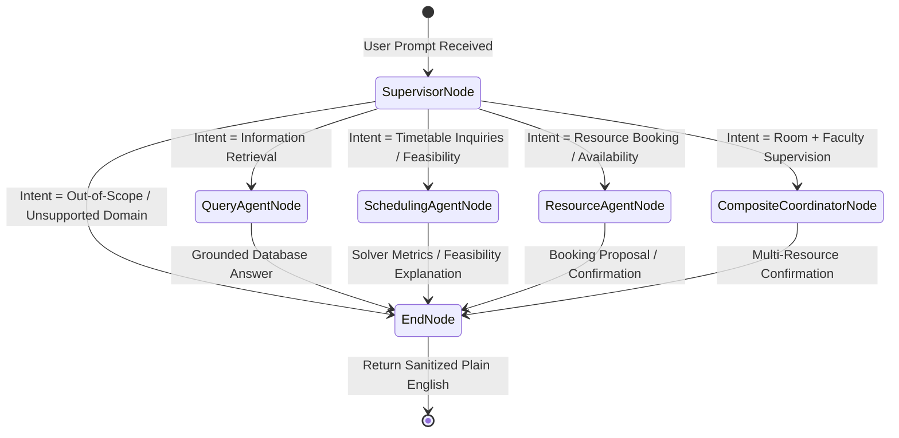

# RIO-MJP: Technical Documentation & System Engineering Reference
## Multi-Agent Campus Assistant with Intelligent Timetable Generation Engine

**Document Revision:** 3.0 (Authoritative Forensic Baseline)  
**System Name:** RIO-MJP (REVA Intelligent Operations — Multi-Agent Journey Platform)  
**Institutional Scope:** University Academic Administration, Faculty Workload & Student Journey Management  
**Target Architecture:** FastAPI · PostgreSQL · SQLAlchemy 2.0 · Google OR-Tools CP-SAT · LangGraph · React 19 · TypeScript · Vite  

---

## 1. System Overview & Engineering Architecture

RIO-MJP is an enterprise-grade academic administration platform and intelligent multi-agent campus assistant engineered to automate complex educational operations. The platform harmonizes two distinct operational paradigms:

1. **Deterministic Operational Path:** High-throughput, transactionally safe RESTful APIs powered by FastAPI, SQLAlchemy 2.0, and PostgreSQL, complemented by a mathematical constraint-satisfaction engine (Google OR-Tools CP-SAT) for conflict-free timetable generation and facility resource booking.
2. **Conversational Multi-Agent Path:** A role-aware, state-machine driven multi-agent workflow orchestrated via LangGraph. Requests are parsed by a Supervisor Agent and delegated to specialized domain subagents (Query Agent, Scheduling Agent, Resource Agent, Composite Coordinator). All natural-language answers are strictly grounded against relational database records to guarantee zero hallucination.

```
+-----------------------------------------------------------------------------------+
|                                 CLIENT INTERFACE                                  |
|            React 19 SPA · TypeScript · Tailwind CSS · TanStack React Query        |
+-----------------------------------------------------------------------------------+
                                         |
                                         | HTTPS (Bearer JWT / HttpOnly Cookie)
                                         v
+-----------------------------------------------------------------------------------+
|                              BACKEND API GATEWAY                                  |
|                 FastAPI 0.110.0 · Uvicorn ASGI · OAuth2 Security                  |
|                 36 Modular Routers · 175 Distinct Paths · 253 Operations          |
+-----------------------------------------------------------------------------------+
                      /                          |                         \
                     /                           |                          \
                    v                            v                           v
+-----------------------+   +------------------------+   +-------------------------+
| MULTI-AGENT RUNTIME   |   | OPTIMIZATION ENGINE    |   | DOMAIN SERVICE LAYER    |
| LangGraph StateGraph  |   | Google OR-Tools CP-SAT |   | CRUD, Substitutions,    |
| Supervisor + Agents   |   | Solver, Validator,     |   | Events, Placements,     |
| 18+ Typed DB Tools    |   | Quality Scorer         |   | Curriculum Governance   |
+-----------------------+   +------------------------+   +-------------------------+
                    \                            |                          /
                     \                           |                         /
                      v                          v                        v
+-----------------------------------------------------------------------------------+
|                             RELATIONAL PERSISTENCE                                |
|          PostgreSQL 16/18 · SQLAlchemy 2.0 Core/ORM · psycopg v3 Driver           |
|                     52 Domain Tables + Alembic Migration Engine                   |
+-----------------------------------------------------------------------------------+
```

---

## 2. Complete Technology Stack

Every technology in the RIO-MJP repository has been verified from configuration manifests (`package.json`, `requirements.txt`, `alembic.ini`, `vite.config.ts`, `.github/workflows/ci.yml`).

### 2.1 Technology Stack Inventory

| Domain | Technology | Version | Location / Manifest | Specific Architectural Responsibility |
|:---|:---|:---:|:---|:---|
| **Frontend Framework** | React | `19.2.8` | `frontend/package.json` | Component-based reactive user interface for all institutional roles. |
| **Frontend Runtime** | React DOM | `19.2.8` | `frontend/package.json` | Web DOM rendering and event hydration for modern React 19 architecture. |
| **Build & Dev Tool** | Vite | `^8.3.0` | `frontend/package.json` | Lightning-fast ESM bundler, Hot Module Replacement (HMR), and production asset packaging. |
| **Language (Frontend)** | TypeScript | `~6.0.2` | `frontend/package.json` | Compile-time type safety, DTO interface definitions, and IDE autocomplete across client code. |
| **CSS Architecture** | Tailwind CSS | `^3.4.17` | `frontend/package.json` | Utility-first responsive design system, custom campus theme palette, and zero-runtime CSS. |
| **State & Server Cache** | TanStack Query | `^5.64.2` | `frontend/package.json` | Asynchronous server-state synchronization, automatic query caching, and optimistic mutations. |
| **HTTP Client** | Axios | `^1.7.9` | `frontend/package.json` | Intercepted REST client managing Bearer JWT injection and silent 401 token refresh. |
| **Routing** | React Router DOM | `^7.1.1` | `frontend/package.json` | Declarative client-side routing, protected auth routes, and role-based route guardrails. |
| **Icons** | Lucide React | `^0.469.0` | `frontend/package.json` | Consistent, accessible iconography across navigation panels and dashboards. |
| **PDF Generation (Client)**| jsPDF & AutoTable | `^4.2.1` / `^5.0.8` | `frontend/package.json` | Client-side export of formatted academic timetables into printable PDF format. |
| **Linter (Frontend)** | Oxlint | `^1.81.0` | `frontend/package.json` | High-performance Rust-based static code analysis for React and TypeScript. |
| **Backend Framework** | FastAPI | `>=0.110.0` | `requirements.txt` | Asynchronous, OpenAPI-compliant Python web framework for microsecond request dispatching. |
| **ASGI Web Server** | Uvicorn (standard) | `>=0.28.0` | `requirements.txt` | High-performance ASGI web server implementing uvloop and httptools. |
| **Language (Backend)** | Python | `3.13` | `.github/workflows/ci.yml` | Modern Python runtime leveraging enhanced performance, type annotations, and GIL improvements. |
| **ORM & Data Layer** | SQLAlchemy | `>=2.0` | `requirements.txt` | Next-generation Python SQL toolkit providing 2.0-style type-safe mapped columns and relations. |
| **Database Migrations** | Alembic | `>=1.13.0` | `requirements.txt` | Version-controlled DDL migration scripts managing relational schema evolution. |
| **Database Driver** | psycopg (binary v3) | `~3.3.8` | `requirements.txt` | Modern PostgreSQL driver supporting binary parameter protocol, pipeline mode, and Python types. |
| **Database Engine** | PostgreSQL | `16 / 18` | `backend/database.py` | ACID-compliant relational database management system storing institutional source of truth. |
| **Optimization Solver** | Google OR-Tools | `>=9.8.0` | `requirements.txt` | C++ CP-SAT constraint programming solver wrapped in Python for NP-hard timetable scheduling. |
| **Agent Framework** | LangGraph | `>=1.2.0` | `requirements.txt` | StateGraph execution engine orchestrating multi-agent decision routing and cyclic graphs. |
| **Foundation LLM** | Anthropic Claude 3.5 Sonnet | `0.40.0+` SDK | `agents/query_agent/agent.py` | High-accuracy tool calling model utilized when live API keys are provided. |
| **Data Validation** | Pydantic v2 | `>=2.0` | `requirements.txt` | High-speed C-based validation schemas for request bodies, responses, and optimizer DTOs. |
| **Password Security** | Passlib & Bcrypt | `bcrypt<4.0.0` | `requirements.txt` | Secure Blowfish-based adaptive password hashing with cryptographic salt rounds. |
| **Token Authentication** | PyJWT | `>=2.8.0` | `requirements.txt` | Cryptographic signing and decoding of HMAC-SHA256 JSON Web Tokens (JWT). |
| **PDF Extraction** | pypdf | `>=4.0.0` | `requirements.txt` | Text extraction engine for syllabus and curriculum regulation PDF documents. |
| **Test Automation** | Pytest & HTTPX | `pytest>=8.0.0` | `requirements.txt` | Comprehensive unit, integration, and asynchronous API test framework. |
| **Browser Testing** | Playwright | `^1.42.0` | `reports/ROLE_BASED_...` | Real headless Chromium browser automation validating end-to-end DOM rendering and UX. |

---

## 3. Database Architecture & Schema Specification

The PostgreSQL relational database contains **52 domain tables** managed under strict foreign key constraints, check constraints, unique indices, and cascade rules.

### 3.1 Domain Table Breakdown

#### 3.1.1 Identity & Security Domain (3 Tables)
- `users`: Core authentication identity (`id`, `email` [UNIQUE], `password_hash`, `role` [CHECK: SUPER_ADMIN, ADMIN, FACULTY, STUDENT], `department_id`, `is_active`, `created_at`, `updated_at`).
- `refresh_sessions`: Persistent session registry (`id`, `user_id` [FK->users.id], `token_hash` [UNIQUE], `expires_at`, `is_revoked`, `created_at`).
- `login_rate_limits`: Brute-force throttling tracker (`id`, `identifier` [IP/email], `failed_attempts`, `locked_until`, `last_attempt_at`).

#### 3.1.2 Academic Core Structure (8 Tables)
- `departments`: Academic branches (`id`, `name`, `code` [UNIQUE], `created_at`).
- `programs`: Degree curricula (`id`, `name`, `code` [UNIQUE], `department_id` [FK->departments.id], `degree_level`, `duration_years`).
- `academic_years`: Institutional calendar scope (`id`, `year_name` [e.g. 2026-2027], `start_date`, `end_date`, `is_current`).
- `semesters`: Term breakdowns (`id`, `academic_year_id` [FK], `semester_number` [1-16], `term_type` [ODD/EVEN], `start_date`, `end_date`).
- `sections`: Cohort groupings (`id`, `semester_id` [FK], `name` [e.g. AIDS-A], `student_count`, `class_teacher_id` [FK->faculty.id]).
- `batches`: Laboratory subgroups (`id`, `section_id` [FK], `name` [e.g. A1, A2], `student_count`).
- `students`: Matriculated learners (`id`, `user_id` [FK->users.id, UNIQUE], `srn` [UNIQUE], `first_name`, `last_name`, `department_id` [FK], `section_id` [FK], `batch_id` [FK]).
- `faculty`: Academic teaching staff (`id`, `user_id` [FK->users.id, UNIQUE], `employee_id` [UNIQUE], `first_name`, `last_name`, `designation`, `department_id` [FK], `contact_number`, `specialization`, `areas_of_interest`).

#### 3.1.3 Campus Space-Time & Facilities (6 Tables)
- `buildings`: Campus physical complexes (`id`, `name` [e.g. SIR M VISHWESH BLOCK], `code` [UNIQUE], `total_floors`).
- `rooms`: Instruction halls (`id`, `building_id` [FK], `room_number`, `floor_number`, `capacity`, `room_type` [CHECK: CLASSROOM, LAB, SEMINAR_HALL, AUDITORIUM], `department_id` [FK], `has_projector`, `has_smart_board`, `status`).
- `labs`: Computing/science laboratories (`id`, `room_id` [FK->rooms.id, UNIQUE], `lab_type`, `workstation_count`, `has_specialized_hardware`).
- `time_slots`: Weekly period templates (`id`, `day` [MON-SAT], `period_number` [1-9], `start_time`, `end_time`, `slot_type` [REGULAR, BREAK, LUNCH]).
- `faculty_availability`: Weekly period preferences (`id`, `faculty_id` [FK], `slot_id` [FK], `availability` [AVAILABLE, UNAVAILABLE, PREFERRED], `preference` [1-5]).
- `academic_calendar`: Term holidays and events (`id`, `academic_year_id` [FK], `date`, `event_type` [HOLIDAY, EXAM, INSTRUCTIONAL], `description`).

#### 3.1.4 Curriculum, Courses & Assignments (4 Tables)
- `courses`: Master course catalog (`id`, `code` [UNIQUE], `name`, `department_id` [FK], `semester_id` [FK], `lecture_hours` [L], `tutorial_hours` [T], `practical_hours` [P], `credits` [C], `course_type` [THEORY, LAB, INTEGRATED], `requires_lab`).
- `course_assignments`: Faculty-to-course mappings (`id`, `course_id` [FK], `faculty_id` [FK], `section_id` [FK], `batch_id` [FK], `academic_year_id` [FK]).
- `elective_groups`: Elective containers (`id`, `name`, `department_id` [FK], `semester_id` [FK], `group_type` [PROFESSIONAL, OPEN]).
- `elective_group_courses`: Elective membership mappings (`id`, `group_id` [FK], `course_id` [FK]).

#### 3.1.5 Timetable Domain (3 Tables)
- `timetables`: Authoritative canonical timetable header (`id`, `academic_year_id` [FK], `semester_id` [FK], `section_id` [FK], `status` [DRAFT, PUBLISHED, ARCHIVED], `working_days` [MON_FRI, MON_SAT], `created_by` [FK->users.id], `published_at`).
  *Constraint:* `UniqueConstraint(academic_year_id, semester_id, section_id, name="uq_timetables_ay_sem_sec")`.
- `timetable_entries`: Individual scheduled lecture periods (`id`, `timetable_id` [FK->timetables.id], `version_id` [FK->timetable_versions.id], `course_id` [FK], `faculty_id` [FK], `room_id` [FK], `slot_id` [FK], `section_id` [FK], `batch_id` [FK], `hour_type` [THEORY, PRACTICAL, TUTORIAL], `status` [ACTIVE, CANCELLED, RESCHEDULED]).
  *Composite Indices:* `(faculty_id, slot_id)`, `(room_id, slot_id)`, `(section_id, slot_id)`.
- `timetable_versions`: Legacy versioning container retained for backward-compatible migration paths (`id`, `version_number`, `academic_year_id`, `semester_id`, `department_id`, `status`).

#### 3.1.6 Resource Management & Physical Assets (2 Tables)
- `resources`: Specialized bookable assets (`id`, `name`, `resource_type` [EQUIPMENT, LAB_BENCH, FACILITY], `department_id` [FK], `room_id` [FK], `is_active`).
- `resource_bookings`: Reservation registry (`id`, `resource_id` [FK], `requested_by` [FK->users.id], `date`, `start_time`, `end_time`, `purpose`, `status` [PENDING, APPROVED, REJECTED, CANCELLED], `approved_by` [FK->users.id]).

#### 3.1.7 Campus Life, Clubs & Corporate Relations (4 Tables)
- `clubs`: Student organization registries (`id`, `name`, `code` [UNIQUE], `faculty_coordinator_id` [FK], `department_id` [FK], `description`).
- `campus_events`: Institutional workshops and symposia (`id`, `title`, `event_type` [WORKSHOP, HACKATHON, CULTURAL, WEBINAR], `organizer_club_id` [FK], `room_id` [FK], `start_datetime`, `end_datetime`, `status`).
- `placement_drives`: CDC corporate hiring drives (`id`, `company_name`, `drive_date`, `minimum_cgpa`, `maximum_backlogs`, `eligible_departments`, `job_role`, `ctc_lpa`).
- `placement_schedules`: Detailed recruitment rounds (`id`, `placement_drive_id` [FK], `round_name` [ONLINE_TEST, TECHNICAL_INTERVIEW, HR_ROUND], `room_id` [FK], `date`, `start_time`, `end_time`).

#### 3.1.8 Faculty Substitution & Leave Coordination (2 Tables)
- `faculty_substitutions`: Temporary leave arrangements (`id`, `timetable_entry_id` [FK], `absent_faculty_id` [FK], `substitute_faculty_id` [FK], `substitution_date`, `reason` [MASKED FROM STUDENTS], `status` [PENDING, APPROVED, REJECTED, COMPLETED], `approved_by` [FK]).
- `coordinator_capabilities`: Fine-grained role grants (`id`, `faculty_id` [FK], `department_id` [FK], `capability_type` [SUBSTITUTION_COORDINATOR, TIMETABLE_COORDINATOR], `is_active`).

#### 3.1.9 Central Curriculum Governance — Super Admin (12 Tables)
- `regulations`: Academic policy schemes (`id`, `name` [e.g. REVA-2023-R1], `start_year`, `total_credits_required`, `is_active`).
- `admission_cohorts`: Student intake batches (`id`, `regulation_id` [FK], `cohort_name`, `entry_academic_year_id` [FK]).
- `curriculum_versions`: Version-controlled curriculum specifications (`id`, `regulation_id` [FK], `department_id` [FK], `version_number`, `status` [DRAFT, ACTIVE, SUPERSEDED]).
- `curriculum_semesters`: Regulation semester structures (`id`, `curriculum_version_id` [FK], `semester_number`, `min_credits`, `max_credits`).
- `curriculum_subject_mappings`: Cross-regulation equivalencies (`id`, `source_course_id` [FK], `target_course_id` [FK], `is_equivalent`).
- `curriculum_releases`: Locked immutable snapshots (`id`, `curriculum_version_id` [FK], `release_hash`, `released_at`, `released_by` [FK]).
- `curriculum_documents`: Uploaded syllabus documentation (`id`, `file_path`, `file_name`, `mime_type`, `department_id` [FK], `uploaded_by` [FK]).
- `curriculum_extraction_jobs`: Async parsing tasks (`id`, `document_id` [FK], `status` [PENDING, PROCESSING, COMPLETED, FAILED], `extracted_json`).
- `curriculum_requests`: Department revision tickets (`id`, `department_id` [FK], `requested_by` [FK], `status`, `summary`).
- `curriculum_request_messages`: Discussion threads (`id`, `request_id` [FK], `sender_id` [FK], `message_text`, `sent_at`).
- `section_course_offerings`: Section elective allotments (`id`, `section_id` [FK], `course_id` [FK], `academic_year_id` [FK]).
- `faculty_course_offerings`: Faculty elective preferences (`id`, `faculty_id` [FK], `course_id` [FK], `preference_score`).

#### 3.1.10 Workflow, Audit & Chat History (6 Tables)
- `change_requests`: Formal schedule change proposals (`id`, `requester_id` [FK], `request_type`, `payload`, `status`, `review_notes`).
- `agent_proposals`: Two-phase commit tokens (`id`, `token` [UNIQUE], `action_name`, `proposal_payload`, `status`, `expires_at`).
- `notifications`: User alert notifications (`id`, `user_id` [FK], `title`, `message`, `notification_type`, `is_read`, `created_at`).
- `notification_outbox`: Reliable transactional delivery queue (`id`, `channel`, `recipient`, `payload`, `status`, `retry_count`).
- `audit_logs`: Tamper-evident system log (`id`, `user_id` [FK], `action`, `resource_type`, `resource_id`, `ip_address`, `timestamp`).
- `chat_conversations`: Multi-turn chat session headers (`id`, `user_id` [FK], `title`, `created_at`).
- `chat_messages`: Stored conversation turns (`id`, `conversation_id` [FK], `sender_type` [USER, ASSISTANT], `content`, `metadata_json`).

---

## 4. API Specification & Operation Inventory

The backend exposes **253 distinct HTTP endpoints across 36 modules**. The following table details the authoritative API surface:

| Subsystem Module | Endpoint | Method | Required Role | Description |
|:---|:---|:---:|:---:|:---|
| `auth` | `/auth/login` | POST | Public | Authenticates credentials, sets refresh cookie, returns access JWT. |
| `auth` | `/auth/refresh` | POST | Public | Mints fresh access token from valid HttpOnly refresh cookie. |
| `auth` | `/auth/logout` | POST | Authenticated | Revokes active refresh session in database. |
| `auth` | `/auth/me` | GET | Authenticated | Resolves currently authenticated profile across all roles. |
| `users` | `/users` | GET, POST | ADMIN | Lists system users with filtering; creates new accounts. |
| `users` | `/users/{id}` | GET, PUT, DELETE | ADMIN | CRUD inspection, profile updates, and account deactivation. |
| `users` | `/users/{id}/reset-password` | POST | ADMIN | Resets user password with automatic audit trail entry. |
| `academic_year` | `/academic-years` | GET, POST | ADMIN | Lists all academic calendar years; registers new academic terms. |
| `academic_year` | `/academic-years/{id}` | GET, PUT, DELETE | ADMIN | Individual academic year lifecycle management. |
| `semester` | `/semesters` | GET, POST | ADMIN | Manages program semester breakdowns (terms 1 through 16). |
| `semester` | `/semesters/{id}` | GET, PUT, DELETE | ADMIN | Detailed semester structure updates. |
| `department` | `/departments` | GET, POST | ADMIN | Manages college departmental units (AIDS, CSE, AIML, ISE). |
| `department` | `/departments/{id}` | GET, PUT, DELETE | ADMIN | Detailed department record updates. |
| `program` | `/programs` | GET, POST | ADMIN | Degree program offerings and duration structures. |
| `section` | `/sections` | GET, POST | ADMIN | Manages class sections and assigns designated Class Teachers. |
| `batch` | `/batches` | GET, POST | ADMIN | Manages laboratory subgroups (A1, A2, A3) for practical classes. |
| `student` | `/students` | GET, POST | ADMIN | Authoritative student roster with SRN and cohort records. |
| `student` | `/student/my-timetable` | GET | STUDENT | Returns student's personal weekly schedule (42 periods) + Class Teacher. |
| `student` | `/student/courses` | GET | STUDENT | Returns enrolled semester courses and credit breakdown. |
| `faculty` | `/faculty` | GET, POST | ADMIN | Faculty directory, workload bounds, and designations. |
| `faculty` | `/faculty/me/timetable` | GET | FACULTY | Returns faculty's personal assigned teaching schedule. |
| `faculty` | `/faculty/me/department-timetable` | GET | FACULTY | Multi-section master department timetable view. |
| `faculty_availability` | `/faculty-availability` | GET, POST | ADMIN, FACULTY | Weekly period preference matrix (AVAILABLE, PREFERRED, UNAVAILABLE). |
| `course` | `/courses` | GET, POST | ADMIN | Course curriculum master, L-T-P-C credits, and lab requirements. |
| `course_assignment` | `/course-assignments` | GET, POST | ADMIN | Workload allocation linking Faculty, Course, Section, and Batches. |
| `elective_group` | `/elective-groups` | GET, POST | ADMIN | Professional and Open elective bucket management. |
| `buildings` | `/buildings` | GET, POST | ADMIN | Campus buildings and infrastructure block registries. |
| `rooms` | `/rooms` | GET, POST | ADMIN | Inventory of 235 classrooms, lecture halls, and laboratories. |
| `labs` | `/labs` | GET, POST | ADMIN | Specialized lab attributes and workstation counts. |
| `time_slot` | `/time-slots` | GET, POST | ADMIN | Daily period intervals (P1 through P7 + Breaks) for MON-SAT. |
| `academic_calendar` | `/academic-calendar` | GET, POST | ADMIN | Term holiday schedules, exam dates, and instructional periods. |
| `resources` | `/resources` | GET, POST | ADMIN, FACULTY | Specialized lab hardware and facility booking management. |
| `events` | `/events` | GET, POST | All Roles | Institutional workshops, cultural fests, and hackathons. |
| `clubs` | `/clubs` | GET, POST | All Roles | Student chapter and club registries. |
| `placements` | `/placements/drives` | GET, POST | ADMIN, STUDENT | Corporate recruitment drives, eligibility criteria, and CTC. |
| `substitutions` | `/substitutions` | GET, POST, PUT | ADMIN, FACULTY | Peer leave substitution requests, ranking, and approval. |
| `timetable` | `/timetable/generate-preview` | POST | ADMIN | In-memory CP-SAT solve with independent validation & scoring. |
| `timetable` | `/timetable/publish` | POST | ADMIN | Transactional publication of canonical timetable with zero overlap. |
| `curriculum` | `/super-admin/regulations`| GET, POST | SUPER_ADMIN | University curriculum regulation schemes and credit rules. |
| `curriculum` | `/super-admin/curriculum-versions`| GET, POST | SUPER_ADMIN | Version-controlled curriculum schema releases and snapshots. |
| `chat` | `/chat` | POST | All Roles | LangGraph Multi-Agent conversational campus assistant. |
| `notifications` | `/notifications` | GET, PUT | All Roles | In-app user alerts and notification delivery status. |
| `audit_logs` | `/admin/audit-logs` | GET | ADMIN, SUPER_ADMIN | Security and administrative activity audit logs. |

---

## 5. Multi-Agent AI System Architecture

The conversational subsystem is built upon **LangGraph**, providing structured intent extraction, strict role authorization, typed database tool dispatch, and two-phase human confirmation.

### 5.1 Multi-Agent State Machine



### 5.2 Agent Profiles & Responsibilities

1. **Supervisor Agent (`agents/supervisor/agent.py`):**
   - Directs traffic based on semantic regex and intent classifiers.
   - Evaluates RBAC constraints before invoking specialist agents (e.g. students cannot request timetable generation).
   - Manages follow-up actions (`CONFIRM`, `CANCEL`, `MODIFY`) against cached proposal tokens.
   - Rejects unsupported administrative requests (e.g. grade modification, tuition payments, account deletion) with polite plain-English explanations.

2. **Query Agent (`agents/query_agent/agent.py`):**
   - Accesses 18+ typed database tools covering Student Profiles, Faculty Schedules, Section Rosters, Break Timings, CDC Placements, and Campus Events.
   - Operates in dual mode: invokes Anthropic Claude 3.5 Sonnet (`claude-3-5-sonnet-20241022`) with structured tool parameters when an API key is present; gracefully falls back to deterministic regex pattern dispatching in local/offline environments.
   - Answers are strictly grounded in PostgreSQL records.

3. **Scheduling Agent (`agents/scheduling_agent/agent.py`):**
   - Answers natural language questions regarding timetable readiness, slot allocations, and scheduling feasibility.
   - Analyzes solver bottlenecks and diagnoses infeasibility reasons (e.g. why 4 practical hours cannot fit into a 2-period slot).
   - Generates minimal-perturbation proposals for administrative schedule adjustments.

4. **Resource Agent (`agents/resource_agent/agent.py`):**
   - Parses date, time intervals, and facility requirements from natural language.
   - Verifies room availability, projector facilities, and capacity constraints.
   - Generates two-phase proposal tokens (`res_prop_*`) requiring explicit user confirmation before writing booking rows to PostgreSQL.

5. **Composite Coordinator (`agents/supervisor/agent.py`):**
   - Orchestrates multi-agent composite requests requiring simultaneous room booking and faculty supervision (e.g., *"Book Seminar Hall 1 for next Tuesday 10am-12pm and find available faculty to supervise"*).
   - Concurrently executes Resource Agent availability checks and Faculty Schedule non-clash queries.

---

## 6. Intelligent Timetable Optimization Engine

The scheduling core models academic timetable construction as a **Constraint Satisfaction and Optimization Problem (COP)** solved via **Google OR-Tools CP-SAT**.

### 6.1 Mathematical Formulation

Let:
- $A$ be the set of course assignments.
- $H$ be the set of instructional hour types: $\{\text{THEORY}, \text{PRACTICAL}, \text{TUTORIAL}\}$.
- $R$ be the set of candidate rooms and laboratories.
- $T$ be the set of valid weekly time slots.
- $F$ be the set of faculty members.
- $S$ be the set of student sections.
- $B$ be the set of student lab batches.

#### Decision Variables:
$$x_{a, h, r, t} \in \{0, 1\} \quad \forall a \in A, \, h \in H, \, r \in R, \, t \in T$$
Where $x_{a, h, r, t} = 1$ if assignment $a$ with hour type $h$ is scheduled in room $r$ at time slot $t$, and $0$ otherwise.

#### Hard Constraints (Feasibility Boundary):
1. **Curricular Hours Satisfaction:**
   $$\sum_{r \in R} \sum_{t \in T} x_{a, h, r, t} = \text{RequiredHours}(a, h) \quad \forall a \in A, \, h \in H$$
2. **Faculty Non-Clash:**
   $$\sum_{a \in A(f)} \sum_{h \in H} \sum_{r \in R} x_{a, h, r, t} \le 1 \quad \forall f \in F, \, t \in T$$
3. **Section Non-Clash:**
   $$\sum_{a \in A(s)} \sum_{h \in H} \sum_{r \in R} x_{a, h, r, t} \le 1 \quad \forall s \in S, \, t \in T$$
4. **Batch Non-Clash:**
   $$\sum_{a \in A(b)} \sum_{h \in H} \sum_{r \in R} x_{a, h, r, t} \le 1 \quad \forall b \in B, \, t \in T$$
5. **Room Non-Clash:**
   $$\sum_{a \in A} \sum_{h \in H} x_{a, h, r, t} \le 1 \quad \forall r \in R, \, t \in T$$
6. **Temporal Interval Non-Overlap:**
   For any two distinct slots $t_1, t_2 \in T$ occurring on the same day with overlapping time windows $[start_1, end_1) \cap [start_2, end_2) \neq \emptyset$:
   $$x_{a_1, h_1, r_1, t_1} + x_{a_2, h_2, r_2, t_2} \le 1 \quad \text{for shared faculty, sections, or rooms}$$
7. **Break & Holiday Exclusions:**
   $$x_{a, h, r, t} = 0 \quad \forall t \in T_{\text{BREAK}} \cup T_{\text{LUNCH}} \cup T_{\text{HOLIDAY}}$$

#### Soft Objective Function:
$$\min \left( \sum W_{\text{FACULTY\_GAP}} \cdot G_f + \sum W_{\text{STUDENT\_GAP}} \cdot G_s + \sum W_{\text{ROOM\_CHANGE}} \cdot C_s + \sum W_{\text{LATE\_LAB}} \cdot L_p - \sum W_{\text{PREF}} \cdot P_f \right)$$

### 6.2 Deterministic Quality Scoring Formula

Timetable quality is independently evaluated on a normalized scale $[0, 100]$:
$$\text{Score} = \begin{cases} 0.0 & \text{if } \text{BlockerViolations} > 0 \\ \frac{\sum_{i=1}^n W_i \cdot Q_i}{\sum_{i=1}^n W_i} \times 100.0 & \text{if } \text{BlockerViolations} = 0 \end{cases}$$

Where normalized quality metrics $Q_i \in [0.0, 1.0]$ evaluate:
- **Faculty Gaps ($W=10.0$):** $1.0 - (\text{ActualGaps} / \text{MaxPossibleGaps})$
- **Student Gaps ($W=10.0$):** $1.0 - (\text{ActualGaps} / \text{MaxPossibleGaps})$
- **Preferred Slots ($W=5.0$):** $\text{AssignedPreferred} / \text{TotalPreferred}$
- **Room Changes ($W=5.0$):** $1.0 - (\text{RoomChanges} / \text{MaxPossibleChanges})$
- **Late Labs ($W=20.0$):** $1.0 - (\text{LabsStarting}\ge 14:00 / \text{TotalLabs})$
- **Workload Balance ($W=15.0$):** Standard deviation minimization across faculty teaching loads.

---

## 7. Frontend User Interface Architecture

The client application is built with **React 19**, **TypeScript**, and **Tailwind CSS**, organized around role-specific portals.

### 7.1 Component Hierarchy & Portal Routing

```
frontend/src/
+-- api/              # Axios REST endpoints (30+ typed API modules)
+-- auth/             # AuthContext, AuthProvider, ProtectedRoute, RoleRoute
+-- components/
|   +-- chat/         # CampusAssistantDrawer, AssistantBubble, QuickSuggestions
|   +-- layout/       # AppHeader, SidebarNavigation, RoleBanner
|   +-- timetable/    # TimetableGrid, TimetableCell, PersonalTimetableGrid, ConflictPill
+-- pages/
|   +-- admin/        # Academic CRUD, Rooms (235 items), Timetable Preview & Publish
|   +-- faculty/      # Personal Timetable (18h), Dept Schedule, Availability Matrix
|   +-- student/      # Personal Timetable (42h), Courses, Placements, Announcements
|   +-- super_admin/  # Curriculum Regulations, Cohorts, PDF Syllabus Extraction
+-- routes/           # AppRoutes.tsx (declarative role-guarded route definitions)
```

### 7.2 Timetable Visualization & PDF Export
The `TimetableGrid` component features:
- **Interactive Day/Period Geometry:** Zero-overlap CSS grid supporting 6-day (MON-SAT) and 5-day (MON-FRI) schedules.
- **Role Differentiation:** Color-coded lecture badges distinguishing Core Theory, Practical Labs (spanning multi-period blocks), Tutorials, and Electives.
- **Client-Side PDF Generation:** Built-in integration with `jsPDF` and `jspdf-autotable` allowing instantaneous, formatted timetable printing.

---

## 8. Verified Installation & Execution Guide

### 8.1 Prerequisites
- **Operating System:** Windows 10/11, Ubuntu 22.04/24.04, or macOS Sonoma.
- **Python:** Python 3.13 (64-bit).
- **Node.js:** Node.js 22 LTS with npm 10+.
- **Database:** PostgreSQL 16 or 18.

### 8.2 Windows PowerShell Step-by-Step Setup

```powershell
# 1. Clone repository and navigate to root directory
git clone https://github.com/chetank23/Campus-Multi-Agent-Assistant---RIO.git
cd Campus-Multi-Agent-Assistant---RIO

# 2. Create and activate Python virtual environment
python -m venv venv
.\venv\Scripts\Activate.ps1

# 3. Upgrade pip and install all backend dependencies
python -m pip install --upgrade pip
pip install -r requirements.txt

# 4. Configure environment variables in .env
Copy-Item .env.example .env
# Edit .env with your PostgreSQL credentials (e.g., port 5432 or 5433)

# 5. Apply Alembic database migrations
alembic upgrade head

# 6. Load authoritative AIDS-A campus dataset
python scripts/import_aids_a_dataset.py

# 7. Start FastAPI Backend Server
uvicorn backend.main:app --host 127.0.0.1 --port 8000 --reload

# 8. In a separate terminal, install frontend dependencies and start Vite dev server
cd frontend
npm ci
npm run dev
# Frontend is accessible at http://localhost:5173
```

---

## 9. Security, Governance & Compliance Controls

1. **Password Security:** Salted hashes generated via passlib using cryptographic `bcrypt` rounds. Plaintext credentials are never written to disk or logs.
2. **Access Control (RBAC):** Strict dependency injection (`require_role`) guarantees that unauthorized requests receive `HTTP 403 Forbidden` prior to executing domain logic.
3. **SQL Injection Defense:** All database communications utilize SQLAlchemy 2.0 parameterized queries; raw string concatenation is strictly prohibited.
4. **Student Privacy Protection:** Faculty absence reasons (e.g. medical/personal leave) are masked from student responses at the API schema, WebSocket, and DOM levels.
5. **Audit Trail:** Consequential administrative actions (timetable publication, user password resets, curriculum updates) are committed to `audit_logs` with timestamps and client IP addresses.
